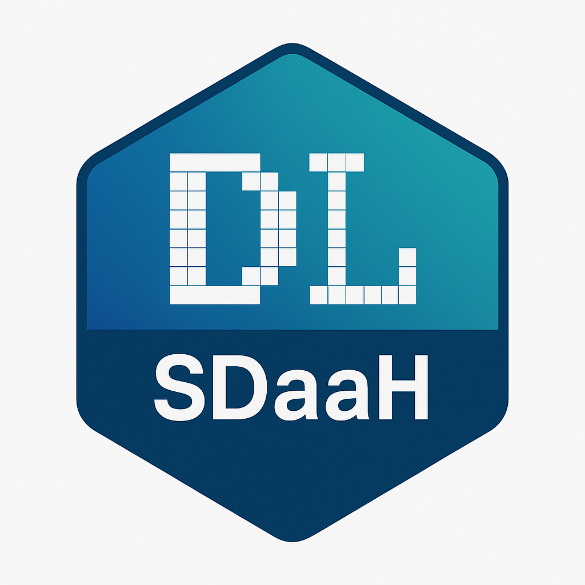

  

# SDaaH – Software Development as a Hobby

*[Deutsche Version / German version](./README.md)*

**SDaaH** stands for *Software Development as a Hobby* – a personal project by **Dietmar Ley**, born out of the joy of programming and the desire to stay creative and curious in retirement.

The idea came up spontaneously while I was looking for a suitable header for a Python GUI application. The well-known term *Software as a Service (SaaS)* came to mind – and from there, the playful variation **SDaaH** evolved.

To me, SDaaH describes exactly what programming means to many people: a creative hobby that is fun, keeps the mind sharp, and constantly sparks new ideas.

---

## 🎯 What is SDaaH?

SDaaH is not a product, a company, or a commercial project. It is a small personal philosophy:

> **Coding because it brings joy.**
> **Learning because it inspires.**
> **Developing because it keeps the mind alive.**

This is a space for small tools, experiments, learning projects, and anything else that sparks my technical interest – without pressure, without obligations.

---

## 🧩 Project Goals

- Try out new things and keep learning
- Bring small software ideas to life
- Keep the fun in coding
- Document and share projects
- Express creativity in retirement

---

## 👤 About Me

I am Dietmar Ley, a hobby developer who has stayed curious. After a long career in the mainframe world (including working as a systems programmer for MVS, OS/390, and z/OS, as well as in 2nd-level support at Amdahl), I now use my experience in error analysis (Problem Determination) for personal projects.

My fascination with code hasn't let go of me in retirement – though today, it serves as a mental challenge, a creative tool, and a purely personal hobby. SDaaH is my space to make this joy visible.

---

## 🛠️ Current Projects

Here I share tools inspired by my mainframe experience in Problem Determination, translated into modern web and desktop technologies:

### 🐘 abend-diagnostic (PHP / MVC)
Structured error handling for PHP MVC applications, heavily inspired by the principles of classic mainframe diagnostic tools (Abenddump, Snapdump, Debugdump, and Trace). It helps capture system states precisely when an error occurs.

### 🐍 DumpViewer & Grid-Layout (Python / PySide6)
A visual DumpViewer whose user interface is based on a custom-built, dynamic `grid_layout_generator`. The project comes in two variants:
1. **The Test Version:** An interactive tool to visually preview and verify grid layouts (grid areas, grid area templates) in advance.
2. **The Production Version:** The finished, high-performance interface for daily use within the DumpViewer.

---

## 📂 Status & Support

This repository grows whenever the mood strikes – true to the spirit of *Software Development as a Hobby*.

⛔ **Support Notice:** These projects are purely a retirement hobby. Upon release, the code is shared "as is". No active support is provided, and inquiries or feature requests unfortunately cannot be answered. Thank you for your understanding!
